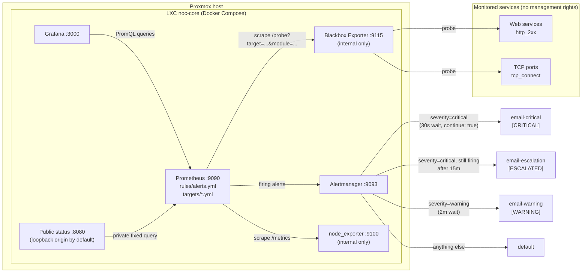

# Monitoring stack

A lightweight Network Operations Center (NOC) built for a student project. It watches services from the outside, using HTTP and TCP probes, so it works for services we have no management rights on. It also collects machine metrics with node_exporter where we are allowed to install it. Alerts go out by email, split by severity, with grouping, inhibition, maintenance silences and escalation.

The stack runs as Docker Compose on an LXC container called **noc-core** on a Proxmox host.

## Architecture



## Features

**Final Grafana scope — 20 November 2026:** Host Systems and Disk Health plus Proxmox VM and LXC Monitoring are accepted as final. Blackbox/service-check recipes and their earlier test results below are retained stack capabilities, not prerequisites for these two dashboards. See the [current Grafana guide](grafana/README.md).

### Working

Tested end to end:

- **Black-box probes** (HTTP 2xx, TCP connect) through Blackbox Exporter. Targets live in `prometheus/targets/*.yml` and are picked up without a restart (file-based service discovery).
- **Alert `ServiceDown`** (critical): a probe has been failing for 2 minutes.
- **Alert `ServiceSlow`** (warning): an HTTP probe succeeds but takes more than 1 s, for 5 minutes.
- **Alert `DiskSpaceLow`** (warning): less than 15 % free disk space, for 10 minutes.
- **Alert `MonitoringCheckFailed`** (critical): Prometheus cannot scrape node_exporter or Blackbox Exporter, which means the monitoring itself is blind.
- **Email routing by severity**: critical and warning go to separate receivers with their own subject and timing.
- **Grouping**: alerts with the same `alertname` and `host` are bundled into one email.
- **Maintenance silences** through the Alertmanager UI or `amtool`.
- **Escalation**: a critical alert that is still firing after 15 minutes also goes to an escalation receiver, and it gets a resolved email too.
- **Host metrics** for noc-core itself through node_exporter.
- **Host metrics for the Proxmox host** (node_exporter, Debian package): filesystems including ZFS pools and per-LXC volumes, CPU/NVMe/NIC temperatures and ZFS pool health.
- **Drive health** through smartctl_exporter (SMART status and drive temperatures of the physical drives).
- **Host disk SMART table**: Host Systems and Disk Health displays overall SMART status per host/device as Passed, Failed or Unknown. Select Disk host independently and collect smartctl metrics on the physical host; see the [current guide](grafana/README.md#host-dashboard-requirements).
- **Alerts for drives, ZFS and temperatures**: `SmartStatusFailed`, `DriveNotReadable`, `ZfsPoolNotOnline` and five temperature alerts (`HostTemperatureHigh`/`Critical`, `NvmeTemperatureHigh`, `DriveTemperatureHigh`/`Critical`). All were tested by flipping their condition, with the firing and resolved emails. `DriveNotReadable` fired for a real faulted drive.
- **Proxmox guests** through pve-exporter (read-only API token): the status of every VM and LXC. Guests are chosen with Proxmox tags: `monitored-critical` (critical alert after 2 minutes) and `monitored-warning` (warning alert after 5 minutes). Both alerts were tested end to end on a stopped LXC, with the firing and resolved emails. See [docs/how-to-guides.md](docs/how-to-guides.md#monitor-proxmox-guests-with-pve-exporter).
- **Extra checks**: a TCP check on SSH (`tcp_connect`), an HTTPS target with a self-signed certificate (`http_2xx_insecure`, Proxmox web UI) and an application check that needs HTTP 200 **and** `"database": "ok"` in Grafana's health answer (`http_grafana_health`). Each one was shown failing when broken on purpose, with the `ServiceDown` firing and resolved emails for the TCP and application checks.
- **Alert `CertificateExpiringSoon`** (warning): an HTTPS certificate expires within 14 days. Tested by flipping the threshold, with firing and resolved emails.
- **Flip test**: a way to prove an alert end to end without breaking anything, see [docs/how-to-guides.md](docs/how-to-guides.md#test-an-alert-by-flipping-its-condition).
- **Grafana** with Prometheus as a data source (added by hand).
- **HTTPS certificate display**: the operator confirmed the manually configured certificate-days panel works in the homelab on 16 October 2026. The public HTTPS probe initially failed because of missing IPv6 routing; preferring IPv4 fixed it ([recorded issue and fix](docs/adding-targets.md#if-the-public-https-probe-reports-ipv6-network-is-unreachable)). This is display/metric verification, not a critical-certificate notification test.
- **Final Grafana dashboards**: physical-host metrics and automatic Proxmox VM/LXC inventory, state, resources and per-node summaries. The two-dashboard scope is final; service catalogues and group budgets are archived references.
- **Grafana validation**: both current dashboards are operator accepted; live Proxmox screenshots show 114 discovered guests, 73 running, 41 stopped and 0 Unknown. See the [final acceptance record](grafana/docs/validation-and-acceptance.md). Earlier service-dashboard tests and restore results are retained in the [archive](grafana/docs/archive/README.md).

Implemented with live acceptance pending:

- **Sanitized public status page**: a separate component publishes only approved aliases and Up/Down using existing Blackbox probes. The operator confirmed the live homelab healthy baseline on 20 October 2026 with three separate Up rows. Controlled live failures and external publication remain pending. No raw Prometheus/Grafana access is exposed by it. [Setup, tests and publication](docs/public-status-page.md).

Written but not tested:

- **Alert `CertificateExpiryCritical`** (critical): a certificate expires within 3 days or has expired. Its flip test is pending.
- **Alert `DiskWillFillSoon`** (warning): a linear forecast says the disk is full within 24 hours. It needs hours of real disk growth to test, so it has not fired yet.
- **Alert `DriveDisappeared`** (critical): a drive that reported SMART data 24 hours ago and does not now. A real test needs a drive to be unplugged.

Recipes in [docs/how-to-guides.md](docs/how-to-guides.md) that have not been tried on this setup yet are marked **Untested** there.

### Planned (not built yet)

- Loki for logs
- Public status-page acceptance and approved HTTPS route; the [sanitized component](docs/public-status-page.md) has a confirmed homelab healthy baseline, with live failures, disclosure inspection and public routing still pending
- Grafana dashboards as code (provisioning)
- Full-stack/data backup and restore of Prometheus, Grafana and Alertmanager; dashboard JSON restore is recorded separately above
- Automated deployment with Ansible/Terraform

## Quick start

Full explanation, prerequisites and checks are in [docs/setup.md](docs/setup.md).

```bash
git clone https://github.com/Jschacht06/monitoring.git /opt/monitoring
cd /opt/monitoring
cp compose-template.yaml compose.yaml
nano compose.yaml                      # replace <your-host> with the noc-core IP (twice)
cp prometheus/template.yml prometheus/prometheus.yml
cp alertmanager/template.yml alertmanager/alertmanager.yml
cp pve/template.yml pve/pve.yml
nano pve/pve.yml                       # Proxmox API token, or delete the pve-exporter service from compose.yaml
nano alertmanager/alertmanager.yml     # fill in SMTP settings and recipients
cp status-page/config-template.json status-page/services.json
nano status-page/services.json        # choose public rows and replace every check placeholder with exact target labels
docker compose build status-page
docker compose run --rm --no-deps --entrypoint python status-page -B -c 'from server import load_services; load_services("/config/services.json"); print("Status mapping valid")'
docker compose up -d
docker compose ps                      # all seven configured services should be "Up"
```

Then open Prometheus on `http://<noc-core-ip>:9090`, Grafana on `http://<noc-core-ip>:3000` and Alertmanager on `http://<noc-core-ip>:9093`.

The quick start does not add probe targets automatically. Before filling the public mapping, add your first target file as described in [docs/setup.md](docs/setup.md#5-create-prometheusyml-and-add-your-first-targets), then copy the exact target labels into the mapping using the [status-page guide](docs/public-status-page.md). Continue to startup only after Status mapping valid is printed. If the page is not needed, omit its mapping/build steps and remove the status-page service block from your local compose.yaml.

## Repo layout

```text
.
├── README.md                     # This file
├── compose-template.yaml         # Monitoring stack including status-page; copy to compose.yaml and customize
├── .gitignore                    # Keeps local configs, secrets, real targets and proposed API/budget copies out of Git
├── alertmanager/
│   └── template.yml              # Alertmanager config template; copy to alertmanager.yml and add SMTP + recipients
├── blackbox/
│   └── blackbox.yml              # Blackbox Exporter probe modules: http_2xx, tcp_connect and HTTP variants
├── pve/
│   └── template.yml              # pve-exporter config template; copy to pve.yml (ignored by Git) and add the API token
├── prometheus/
│   ├── template.yml              # Prometheus config template; copy to prometheus.yml (ignored by Git) and edit the copy
│   ├── prometheus.yml            # Your own copy: scrape jobs, rule files, Alertmanager address (ignored by Git, holds host IPs)
│   ├── rules/
│   │   └── alerts.yml            # All alert rules (availability, capacity, drives, storage, hardware, proxmox, monitoring-health)
│   └── targets/
│       └── template.yml          # Template for probe target files; real files (*.yml) are ignored by Git
├── docs/
│   ├── README.md                         # Index of all monitoring and dashboard guides
│   ├── setup.md                          # Setup from scratch on a Proxmox LXC
│   ├── adding-targets.md                 # How to add services and hosts to monitor
│   ├── configuration-reference.md        # Every config file explained
│   ├── how-to-guides.md                  # Recipes: thresholds, routing, inhibition, silences, escalation, ...
│   └── operations-and-troubleshooting.md # Daily commands, applying changes, known problems, security
└── grafana/
    ├── README.md                              # Current dashboard import, filters and acceptance guide
    ├── host-systems-and-disk-health.json       # Full Node Exporter metrics plus SMART disk health
    ├── proxmox-resources-and-group-budgets.json # Automatic VM/LXC inventory, states, guest resources and summaries by node
    ├── old templates/                         # Previous project JSON files, unchanged
    └── docs/
        ├── README.md                          # Final dashboard documentation index
        ├── operations-and-troubleshooting.md  # Operator access, export, restore and troubleshooting
        ├── validation-and-acceptance.md       # Final status and live/query evidence
        ├── dashboard-sources.json             # Original source/template fingerprints
        └── archive/                           # Retired service-check and group-budget procedures
```

## Documentation

| Document | Read it when you want to... |
|---|---|
| [docs/setup.md](docs/setup.md) | Install the stack from scratch |
| [docs/adding-targets.md](docs/adding-targets.md) | Monitor a new service or host |
| [docs/configuration-reference.md](docs/configuration-reference.md) | Understand what each setting does |
| [docs/how-to-guides.md](docs/how-to-guides.md) | Change thresholds, routing, inhibition, silences, escalation, receivers or secrets |
| [docs/operations-and-troubleshooting.md](docs/operations-and-troubleshooting.md) | Run the stack day to day and fix common problems |
| [docs/README.md](docs/README.md) | Find monitoring guides and the final host/guest dashboard documentation |
| [grafana/docs/README.md](grafana/docs/README.md) | Find the final host/guest dashboard setup, operations and acceptance guides |
| [grafana/README.md](grafana/README.md) | Import the two host/guest dashboards and check their filters, prerequisites and acceptance |
| [Host Systems and Disk Health](grafana/host-systems-and-disk-health.json) | Import complete Node Exporter metrics and SMART health |
| [Proxmox VM and LXC Monitoring](grafana/proxmox-resources-and-group-budgets.json) | Import automatic VM/LXC inventory, states, guest resource usage and summaries by node |
| [Grafana operations](grafana/docs/operations-and-troubleshooting.md) | Operate, export, restore and troubleshoot the final two dashboards |
| [Grafana acceptance](grafana/docs/validation-and-acceptance.md) | Review final status and the live/local validation results |
| [Grafana archive](grafana/docs/archive/README.md) | Consult older service-check/budget procedures and historical results |
