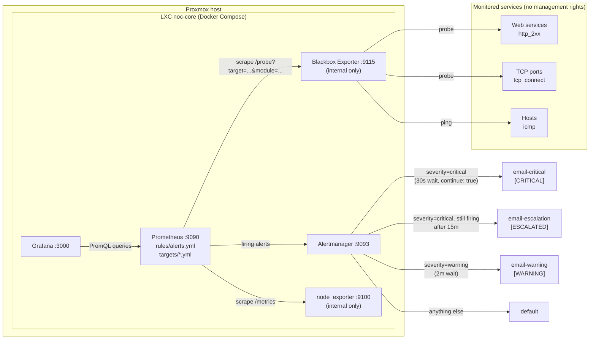

# Monitoring stack

A lightweight Network Operations Center (NOC) built for a student project. It watches services from the outside, using HTTP, TCP and ICMP probes, so it works for services we have no management rights on. It also collects machine metrics with node_exporter where we are allowed to install it. Alerts go out by email, split by severity, with grouping, inhibition, maintenance silences and escalation.

The stack runs as Docker Compose on an LXC container called **noc-core** on a Proxmox host.

## Architecture



## Features

### Working

Tested end to end:

- **Black-box probes** (HTTP 2xx, TCP connect, ICMP) through Blackbox Exporter. Targets live in `prometheus/targets/*.yml` and are picked up without a restart (file-based service discovery).
- **Alert `ServiceDown`** (critical): a probe has been failing for 2 minutes.
- **Alert `ServiceSlow`** (warning): an HTTP probe succeeds but takes more than 1 s, for 5 minutes.
- **Alert `DiskSpaceLow`** (warning): less than 15 % free disk space, for 10 minutes.
- **Alert `MonitoringCheckFailed`** (critical): Prometheus cannot scrape node_exporter or Blackbox Exporter, which means the monitoring itself is blind.
- **Email routing by severity**: critical and warning go to separate receivers with their own subject and timing.
- **Grouping**: alerts with the same `alertname` and `host` are bundled into one email.
- **Inhibition**: a failing ICMP probe on a host suppresses the `ServiceDown` alerts of HTTP probes on the same host.
- **Maintenance silences** through the Alertmanager UI or `amtool`.
- **Escalation**: a critical alert that is still firing after 15 minutes also goes to an escalation receiver, and it gets a resolved email too.
- **Host metrics** for noc-core itself through node_exporter.
- **Host metrics for the Proxmox host** (node_exporter, Debian package): filesystems including ZFS pools and per-LXC volumes, CPU/NVMe/NIC temperatures and ZFS pool health.
- **Drive health** through smartctl_exporter (SMART status and drive temperatures of the physical drives).
- **Alerts for drives, ZFS and temperatures**: `SmartStatusFailed`, `DriveNotReadable`, `ZfsPoolNotOnline` and five temperature alerts (`HostTemperatureHigh`/`Critical`, `NvmeTemperatureHigh`, `DriveTemperatureHigh`/`Critical`). All were tested by flipping their condition, with the firing and resolved emails. `DriveNotReadable` fired for a real faulted drive.
- **Flip test**: a way to prove an alert end to end without breaking anything, see [docs/how-to-guides.md](docs/how-to-guides.md#test-an-alert-by-flipping-its-condition).
- **Grafana** with Prometheus as a data source (added by hand).
- **Service catalogue documentation and dashboard template**: ownership, contacts and dependencies; see [docs/service-catalogue.md](docs/service-catalogue.md).

Written but not tested:

- **Alert `DiskWillFillSoon`** (warning): a linear forecast says the disk is full within 24 hours. It needs hours of real disk growth to test, so it has not fired yet.
- **Alert `DriveDisappeared`** (critical): a drive that reported SMART data 24 hours ago and does not now. A real test needs a drive to be unplugged.
- **Health/resource dashboard guides and templates**: a next-step implementation guide, two manual-import dashboards and proposed Smith API/resource-budget rules. They have not been imported or tested on the running school/home environment; see [docs/health-and-usage-dashboards.md](docs/health-and-usage-dashboards.md).

Recipes in [docs/how-to-guides.md](docs/how-to-guides.md) that have not been tried on this setup yet are marked **Untested** there.

### Planned (not built yet)

- Loki for logs
- Public or internal status page
- Proxmox API exporter (per-LXC/VM metrics and quotas)
- Grafana dashboards as code (provisioning)
- Backup and restore of Prometheus, Grafana and Alertmanager data
- Automated deployment with Ansible/Terraform

## Quick start

Full explanation, prerequisites and checks are in [docs/setup.md](docs/setup.md).

```bash
git clone https://github.com/Jschacht06/monitoring.git /opt/monitoring
cd /opt/monitoring
cp compose-template.yaml compose.yaml
nano compose.yaml                      # replace <your-host> with the noc-core IP (twice)
cp prometheus/template.yml prometheus/prometheus.yml
cp alertmanager/template.yml alertmanager/alertmanager.yml
nano alertmanager/alertmanager.yml     # fill in SMTP settings and recipients
docker compose up -d
docker compose ps                      # all five services should be "Up"
```

Then open Prometheus on `http://<noc-core-ip>:9090`, Grafana on `http://<noc-core-ip>:3000` and Alertmanager on `http://<noc-core-ip>:9093`.

The quick start does not add any probe targets yet. Add your first target file as described in [docs/setup.md](docs/setup.md#5-create-prometheusyml-and-add-your-first-targets), then see [docs/adding-targets.md](docs/adding-targets.md) for your own services.

## Repo layout

```text
.
├── README.md                     # This file
├── compose-template.yaml         # Docker Compose stack; copy to compose.yaml (ignored by Git) and set your host IP
├── .gitignore                    # Keeps local configs, secrets, real targets and proposed API/budget copies out of Git
├── alertmanager/
│   └── template.yml              # Alertmanager config template; copy to alertmanager.yml and add SMTP + recipients
├── blackbox/
│   └── blackbox.yml              # Blackbox Exporter probe modules: http_2xx, tcp_connect, icmp
├── prometheus/
│   ├── template.yml              # Prometheus config template; copy to prometheus.yml (ignored by Git) and edit the copy
│   ├── prometheus.yml            # Your own copy: scrape jobs, rule files, Alertmanager address (ignored by Git, holds host IPs)
│   ├── rules/
│   │   └── alerts.yml            # All alert rules (availability, capacity, drives, storage, hardware, monitoring-health)
│   └── targets/
│       └── template.yml          # Template for probe target files; real files (*.yml) are ignored by Git
└── docs/
    ├── setup.md                          # Setup from scratch on a Proxmox LXC
    ├── adding-targets.md                 # How to add services and hosts to monitor
    ├── configuration-reference.md        # Every config file explained
    ├── how-to-guides.md                  # Recipes: thresholds, routing, inhibition, silences, escalation, ...
    ├── operations-and-troubleshooting.md # Daily commands, applying changes, known problems, security
    ├── README.md                        # Index of all monitoring and dashboard guides
    ├── service-catalogue.md              # Target ownership, contacts, dependencies and catalogue checks
    ├── service-catalogue-dashboard.md    # Catalogue creation, export and import
    ├── dashboard-template.json          # Catalogue dashboard import template
    ├── health-and-usage-dashboards.md    # Next step: service health, resource budgets and trends
    ├── smith-resource-metrics.md         # Proposed approved API exporter and resource-budget integration
    ├── service-health-dashboard-template.json # Health dashboard import template
    ├── smith-resources-dashboard-template.json # Resource dashboard import template
    └── smith-resource-rules-template.yml # Placeholder rules; not loaded from docs/
```

## Documentation

| Document | Read it when you want to... |
|---|---|
| [docs/setup.md](docs/setup.md) | Install the stack from scratch |
| [docs/adding-targets.md](docs/adding-targets.md) | Monitor a new service or host |
| [docs/configuration-reference.md](docs/configuration-reference.md) | Understand what each setting does |
| [docs/how-to-guides.md](docs/how-to-guides.md) | Change thresholds, routing, inhibition, silences, escalation, receivers or secrets |
| [docs/operations-and-troubleshooting.md](docs/operations-and-troubleshooting.md) | Run the stack day to day and fix common problems |
| [docs/README.md](docs/README.md) | Find all monitoring and service catalogue guides |
| [docs/service-catalogue.md](docs/service-catalogue.md) | Add ownership, contacts and dependencies to the Grafana service catalogue |
| [docs/service-catalogue-dashboard.md](docs/service-catalogue-dashboard.md) | Create, edit, export and import the catalogue dashboard |
| [docs/dashboard-template.json](docs/dashboard-template.json) | Start from the Grafana catalogue dashboard template |
| [docs/health-and-usage-dashboards.md](docs/health-and-usage-dashboards.md) | Build service-health, Smith resource-budget and historical-trend dashboards |
| [docs/smith-resource-metrics.md](docs/smith-resource-metrics.md) | Prepare approved read-only API access, guest ownership and resource budgets |
| [docs/service-health-dashboard-template.json](docs/service-health-dashboard-template.json) | Import the health/status-history/latency/availability dashboard |
| [docs/smith-resources-dashboard-template.json](docs/smith-resources-dashboard-template.json) | Import the resource allocation/budget/trend dashboard after preparing its metrics |
| [docs/smith-resource-rules-template.yml](docs/smith-resource-rules-template.yml) | Customize the proposed guest mapping and approved-budget recording rules |
