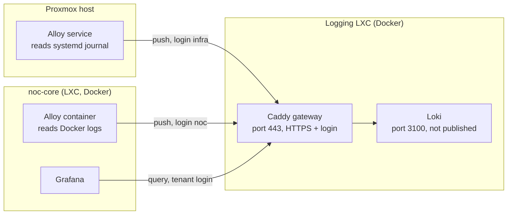

# Architecture

This page explains how the logging setup is built and why. [setup.md](setup.md) is the hands-on guide.

## What it has to do

The brief for this part of the NOC: collect logs from at least two services, delete them after an agreed time, and limit who can read them. The design answers each of those three:

| Requirement | How it is met |
|---|---|
| Logs from 2+ services | Alloy ships the Docker logs of the noc-core stack (tenant `noc`) and an allow-list of units from the Proxmox host journal (tenant `infra`). |
| Delete after an agreed time | Loki's compactor removes data older than `retention_period` (see [configuration-reference.md](configuration-reference.md#logginglokilokiyml)). |
| Limit who can read | Loki has no login, so it is hidden behind a gateway. Each tenant has its own login, and the gateway decides which tenant a request belongs to. |

## Overview

Only port 443 of the logging LXC is reachable. Loki's own port (3100) exists only inside the Docker network of the logging LXC.

## The pieces

| Piece | Runs on | What it does | Version |
|---|---|---|---|
| Loki | Logging LXC, Docker | Stores logs on its own disk and answers queries. One process ("monolithic"), filesystem storage. | 3.7.8 |
| Caddy | Logging LXC, Docker | The gateway. Terminates HTTPS, checks the login, turns the login into a tenant, forwards only the Loki API. | 2.11.7 |
| Alloy (container) | noc-core, Docker | Reads the logs of every Docker container on noc-core through the Docker socket and ships them as tenant `noc`. | 1.20.1 |
| Alloy (service) | Proxmox host, systemd | Reads the systemd journal, keeps only an allow-list of units and ships them as tenant `infra`. | 1.20.1 |
| Grafana | noc-core, Docker | Reads logs from Loki through the gateway (data sources not set up yet, see [README.md](README.md#status--20-october-2026)). | 13.2.2 |

## How one log line travels

1. A program writes a log line (a container prints to stdout, or a service writes to the journal).
2. Alloy reads it and adds labels (`service`, `host`, `owner`).
3. Alloy sends it to `https://<logging-host-ip>/loki/api/v1/push` with the tenant's username and password.
4. Caddy checks the login. If it is wrong, the answer is 401 and nothing is stored. If it is right, Caddy **overwrites** the `X-Scope-OrgID` header with the username and forwards the request to Loki.
5. Loki stores the line under that tenant.
6. A reader (Grafana, or `curl`) asks the gateway with a tenant login. Caddy sets the same header, so the reader only ever sees logs of the tenant it logged in as.

Because Caddy overwrites the header, a client cannot pick its own tenant. This was tested: a `noc` login that sent `X-Scope-OrgID: infra` still only saw its own logs.

## Tenants

A tenant is the "who can read what" boundary. It is **not** the same as the `owner` label:

- **`owner`** is a label on each log line. It tells you who to contact and you can filter by it inside a tenant. It does not stop anyone from reading anything.
- **Tenant** is the lock. If you query as tenant `noc`, the logs of tenant `infra` do not exist for you.

| Tenant (= username) | Source | Why separate |
|---|---|---|
| `noc` | Docker logs of the noc-core stack | The monitoring stack's own logs. |
| `infra` | Proxmox host journal (units `ssh`, `pveproxy`, `pvedaemon`) | Contains login attempts with usernames and source IPs, so it deserves its own lock. |

Adding a tenant is one line in the Caddyfile. Loki itself does not change. The same pattern can later give each user group its own tenant.

## Labels

| Label | Where it comes from | Example |
|---|---|---|
| `service` | Docker: the compose service name, or the container name if there is none. Journal: the unit name without `.service`. | `prometheus`, `ssh` |
| `host` | Environment variable `LOG_HOST` of the Alloy that ships the line. | the machine name |
| `owner` | Environment variable `LOG_OWNER`. | the owner's name |
| `level` | Journal only: the journal priority (`err`, `warning`, `info`, ...). | `info` |
| `service_name`, `detected_level` | Added by Loki itself. | |

Rules:

- Use the **same spelling** for `host` and `owner` as on the Prometheus targets, so metrics and logs line up.
- The tenant is never a label.
- Keep labels few. Every different combination of label values becomes a separate stream in Loki.
- If `LOG_HOST` or `LOG_OWNER` is not set, the label value is `unknown`, so the mistake is visible instead of a missing label.

## Where everything lives

| Machine | What runs there | Files that matter |
|---|---|---|
| Logging LXC | Loki, Caddy (Docker Compose in `/opt/monitoring/logging`) | `compose.yaml`, `caddy/Caddyfile`, `loki/loki.yml`; Docker volumes `loki_data`, `caddy_data`, `caddy_config` |
| noc-core | Alloy container, next to the rest of the stack (Docker Compose in `/opt/monitoring`) | `compose.yaml`, `alloy/noc-core.alloy`, `alloy/logging-root.crt`, `alloy/secrets/logging-password` |
| Proxmox host | Alloy as a package and systemd service | `/etc/alloy/config.alloy`, `/etc/alloy/logging-root.crt`, `/etc/alloy/secrets/logging-password`, `/etc/default/alloy` |

### What is in Git and what is not

The repository is public, so it contains **templates and generic configs only**. Anything that names your network, your machines or your people, and every secret, stays out.

| In Git | Not in Git (git-ignored or outside the repo) |
|---|---|
| `logging/compose-template.yaml` | `logging/compose.yaml` (holds the logging server's address) |
| `logging/caddy/Caddyfile.template` | `logging/caddy/Caddyfile` (holds the password hashes) |
| `logging/loki/loki.yml` | Docker volumes (log data, the gateway's CA key) |
| `alloy/noc-core.alloy`, `alloy/proxmox-host.alloy` (no addresses, host names or owner names inside) | `alloy/secrets/` and `alloy/logging-root.crt` on noc-core |
| `compose-template.yaml` (root; has the `alloy` service) | `compose.yaml` on noc-core (holds `LOGGING_URL`, `LOG_HOST`, `LOG_OWNER`) |
| | `/etc/default/alloy` on the Proxmox host |
| | The two plain passwords (password manager only) |

The Alloy configs read host-specific values from environment variables (`LOGGING_URL`, `LOG_HOST`, `LOG_OWNER`). That way one tracked file serves every machine and `git pull` keeps it current without editing.

## Trust: the certificates

The gateway uses **Caddy's own certificate authority** (`tls internal`), not a public one. This is an internal address, so a public certificate is not possible. The consequences:

- Caddy creates a root certificate and key on first start and stores them in the `caddy_data` volume.
- Every client (each Alloy, and Grafana) needs a copy of the **root certificate** (`root.crt`, a public file) to trust the gateway. On the sources it is saved as `logging-root.crt` and referenced by `ca_file` in the Alloy config. It is not installed system-wide.
- The root certificate is public. The **private key** never leaves the `caddy_data` volume.
- If the `caddy_data` volume is deleted, Caddy makes a new CA and every client needs the new `root.crt`. That is why the volume is part of the backup.
- The gateway's certificate is issued for exactly the value you put in `LOGGING_HOST` (the logging LXC's address). Clients must use that same value in their URL.

## Design decisions

| Decision | Reason |
|---|---|
| Separate logging LXC, not inside noc-core | Logs need their own disk and their own failure domain. If noc-core fills up or breaks, the logs survive. |
| Loki + Alloy | Loki is lightweight (it indexes labels, not the full text) and fits a small lab. Alloy is Grafana's current agent and reads both Docker and the journal. |
| Filesystem storage, single process | Simplest option for one small server. No object store needed. |
| Caddy as gateway | One short config file: HTTPS, basic auth and a header rewrite. nginx would also work but needs more configuration. |
| One tenant per source, username = tenant | Makes "user A cannot read user B" easy to show, and scales to one tenant per user group later. |
| Caddy's own CA, not plain HTTP | Basic-auth passwords would otherwise cross the LAN in clear text. |
| Journal allow-list (`ssh`, `pveproxy`, `pvedaemon`) | Ship only what has a purpose (logins and the Proxmox web/API), not the whole journal. Less data, less privacy exposure. |
| Host-specific values in environment variables | The repository is public. Tracked files must not name the network, machines or people. |
| Docker socket mounted read-only into Alloy | Needed to discover containers and read their logs. Read-only does not make it harmless: access to the Docker socket is effectively root access to the host. **Accepted risk**, recorded in [security.md](security.md). |
