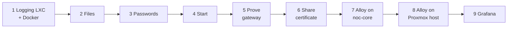

# Setup from scratch

This guide takes you from nothing to a working log server with two log sources: the Docker logs of the noc-core stack and the systemd journal of the Proxmox host. Every step ends with a **Check** that tells you what you should see before you continue. If a check fails, go to [operations-and-troubleshooting.md](operations-and-troubleshooting.md#troubleshooting) before moving on.

Read [architecture.md](architecture.md) first if you want to know what the pieces are. You do not need any knowledge of this project beyond that.

## Before you start

You need:

- A Proxmox host where you are root.
- The noc-core stack, already running as described in [../../docs/setup.md](../../docs/setup.md) (Docker, the repo in `/opt/monitoring`).
- A password manager for two generated passwords.
- A couple of hours. Steps 1–5 build the log server, steps 6–8 connect the two log sources.

Placeholders used in this guide:

| Placeholder | Meaning |
|---|---|
| `<vmid>` | Proxmox container ID of the new logging LXC |
| `<logging-host-ip>` | Address of the logging LXC on your LAN: a fixed IP, or a DNS name that resolves to it. **Every client uses exactly this value**, because the gateway's certificate is issued for it. |
| `<noc-core-ip>` | Address of the noc-core LXC |
| `<proxmox-host-ip>` | Address of the Proxmox host |
| `<this-host-name>` | Machine name for the `host` label of the machine that runs an Alloy. Use the same spelling as the `host` label on your Prometheus targets. |
| `<owner-name>` | Name for the `owner` label. Same spelling as on your Prometheus targets. |

> **Never commit real values.** `logging/compose.yaml`, `logging/caddy/Caddyfile`, `alloy/secrets/`, `alloy/logging-root.crt` and noc-core's `compose.yaml` are in `.gitignore` for that reason. The repository is public.



---

## 1. Create the logging LXC

In the Proxmox web UI, create a container (*Create CT*) with these choices:

| Setting | Value |
|---|---|
| Template | The same as noc-core |
| Unprivileged | Yes |
| Network | A **fixed** address (static IP or a DHCP reservation). Sources and Grafana point at it. |
| Disk | Chosen on purpose: the disk limits how much log history fits. |

Starting point for the size, **not measured on this setup**: 1–2 vCPU, 1–2 GB RAM, 512 MB swap, 20 GB disk. Check real usage after a few days (see [operations-and-troubleshooting.md](operations-and-troubleshooting.md#daily-commands)) and adjust.

Docker inside an LXC needs **nesting**. On the Proxmox host:

```bash
pct set <vmid> --features nesting=1,keyctl=1
pct reboot <vmid>
```

Then, inside the new LXC as root:

```bash
apt update && apt upgrade -y
apt install -y git curl openssl
bash <(wget -qO- https://get.docker.com)
```

**Check:**

```bash
docker --version
docker compose version
docker run --rm hello-world
```

You should see two version numbers and "Hello from Docker!".

## 2. Get the files and create the real ones

```bash
git clone https://github.com/Jschacht06/monitoring.git /opt/monitoring
cd /opt/monitoring/logging
cp compose-template.yaml compose.yaml
cp caddy/Caddyfile.template caddy/Caddyfile
```

The two copies are git-ignored; the originals are templates. **Create `caddy/Caddyfile` before the first `docker compose up`.** If a file that Docker should mount does not exist, Docker creates a *folder* with that name and the container fails.

### 2.1 Fill in the address

Open `compose.yaml` and replace `<logging-host-ip>` (it appears once, under `caddy` → `environment` → `LOGGING_HOST`) with the logging LXC's address.

**Check:**

```bash
grep -n LOGGING_HOST compose.yaml
```

The line must show your real address, not the placeholder.

### 2.2 Check the global block of the Caddyfile

The very top of `caddy/Caddyfile` must be **one** block with these three settings:

```
{
	auto_https disable_redirects
	skip_install_trust
	default_sni {$LOGGING_HOST}
}
```

`default_sni` is essential. Clients that connect to an IP address send no server name, and behind Docker's port mapping Caddy sees the container's own address instead of the LAN address. Without `default_sni`, every connection fails with curl error 35 (`tlsv1 alert internal error`). If your copy of the template does not contain that line, add it.

**Check:**

```bash
grep -n -E "default_sni|auto_https|skip_install_trust" caddy/Caddyfile
```

You should get exactly three lines.

## 3. Create the two passwords and put the hashes in the Caddyfile

There is one login per tenant: `noc` and `infra`. The username is the tenant name.

Generate a strong password for each and store both in your password manager, for example as "logging noc login" and "logging infra login":

```bash
openssl rand -base64 24    # run twice
```

Turn each password into a hash. The gateway only stores hashes; the plain passwords are needed later by Alloy and Grafana.

```bash
docker run --rm -it caddy:2.11.7 caddy hash-password
```

Type the password at the prompt and again to confirm. The output is a line that starts with `$2a$14$`. Open `caddy/Caddyfile` and replace the two `REPLACE_WITH_HASH` entries: the first for `noc`, the second for `infra`.

**Check:** a real hash is exactly 60 characters. Caddy does *not* complain about a damaged hash; the login would just never work.

```bash
awk '$1=="noc" || $1=="infra" {print $1, length($2)}' caddy/Caddyfile
```

Expected:

```
noc 60
infra 60
```

## 4. Start Loki and the gateway

```bash
docker compose up -d
docker compose ps
docker compose logs --tail 20
```

**Check:** both `loki` and `caddy` are `Up`. If Caddy shows `Restarting`, read its log: the usual cause is a second global block or a typo in the Caddyfile (see the troubleshooting table). Loki answers "not ready" for about 20 seconds after it starts.

## 5. Prove the gateway and the tenant isolation

Run all of this in **one terminal session**, because the variables only exist in the shell where you set them. Passwords are typed silently, so the output is safe to share.

```bash
cd /opt/monitoring/logging
H=<logging-host-ip>
docker compose cp caddy:/data/caddy/pki/authorities/local/root.crt /root/logging-root.crt
CA=/root/logging-root.crt
read -rs -p "noc password: " NOCPW; echo
read -rs -p "infra password: " INFRAPW; echo
C="curl -sS --cacert $CA"
```

`/root/logging-root.crt` is the gateway's **root certificate** (public). You will copy it to the sources in step 6.

### 5.1 Access

```bash
$C -o /dev/null -w "ready, no login:   %{http_code}\n" https://$H/ready                                   # 200
$C -o /dev/null -w "api, no login:     %{http_code}\n" -G https://$H/loki/api/v1/labels                   # 401
$C -o /dev/null -w "api, wrong pw:     %{http_code}\n" -u noc:wrong -G https://$H/loki/api/v1/labels      # 401
$C -o /dev/null -w "api, noc good pw:  %{http_code}\n" -u noc:$NOCPW -G https://$H/loki/api/v1/labels     # 200
curl -sS -o /dev/null https://$H/ready                                                                   # error (60): certificate not trusted without the root certificate
curl -sS -m 3 http://$H:3100/ready                                                                       # connection refused: Loki is not reachable directly
```

### 5.2 Tenant isolation

Both tenants push a line with identical labels, so only the tenant separates them. Copy each multi-line command **completely**, including the `-d` line; without it the body is empty and Loki answers 400.

```bash
NOW=$(date +%s%N)
$C -o /dev/null -w "push noc:   %{http_code}\n" -u noc:$NOCPW -H 'Content-Type: application/json' -X POST https://$H/loki/api/v1/push \
  -d '{"streams":[{"stream":{"service":"gateway-test","host":"logging"},"values":[["'$NOW'","line from noc"]]}]}'      # 204
$C -o /dev/null -w "push infra: %{http_code}\n" -u infra:$INFRAPW -H 'Content-Type: application/json' -X POST https://$H/loki/api/v1/push \
  -d '{"streams":[{"stream":{"service":"gateway-test","host":"logging"},"values":[["'$NOW'","line from infra"]]}]}'    # 204
sleep 3
q(){ $C -u "$1" -G https://$H/loki/api/v1/query_range --data-urlencode 'query={service="gateway-test"}' "${@:2}" | grep -o 'line from [a-z]*'; echo "(end)"; }
q noc:$NOCPW                                  # only: line from noc
q infra:$INFRAPW                              # only: line from infra
q noc:$NOCPW -H 'X-Scope-OrgID: infra'        # still only: line from noc (the spoofed header is ignored)
```

### 5.3 Blocked paths

```bash
$C -o /dev/null -w "delete:  %{http_code}\n" -u noc:$NOCPW -X POST "https://$H/loki/api/v1/delete?query=%7Bservice%3D%22gateway-test%22%7D&start=1"   # 403
$C -o /dev/null -w "config:  %{http_code}\n" -u noc:$NOCPW https://$H/config      # 404
$C -o /dev/null -w "metrics: %{http_code}\n" -u noc:$NOCPW https://$H/metrics     # 404
```

**Check:** every line printed the value in its comment. The three that matter most for access control are the 401 without a login, the two `q` results (each tenant sees only its own line) and the unchanged result with the spoofed header. Keep this output as evidence.

The test lines (`service="gateway-test"`) stay in Loki until retention removes them.

## 6. Give the sources the root certificate

Every Alloy needs `/root/logging-root.crt` from step 5 to trust the gateway. Check its fingerprint, then copy it to both sources:

```bash
openssl x509 -in /root/logging-root.crt -noout -fingerprint -sha256
```

| Target | Save it as |
|---|---|
| noc-core | `/opt/monitoring/alloy/logging-root.crt` |
| Proxmox host | `/etc/alloy/logging-root.crt` (the folder exists after step 8.1) |

Use `scp`, for example `scp /root/logging-root.crt root@<noc-core-ip>:/opt/monitoring/alloy/logging-root.crt`, or print it with `cat /root/logging-root.crt` and paste it into the target file with `nano`. Paste everything from `-----BEGIN CERTIFICATE-----` to `-----END CERTIFICATE-----`.

**Check:** on each target, the same `openssl x509 ... -fingerprint -sha256` command prints the identical fingerprint.

## 7. Alloy on noc-core (Docker logs)

Run this on noc-core in `/opt/monitoring`.

### 7.1 Get the files

```bash
cd /opt/monitoring
git pull
ls alloy
```

**Check:** `noc-core.alloy` and `proxmox-host.alloy` are listed.

### 7.2 Certificate

Save the root certificate as `alloy/logging-root.crt` (step 6) and check the fingerprint. **Create this file before starting the container**, or Docker makes a folder of it.

### 7.3 Password file

The file must contain the password of the `noc` login and **no trailing newline**. A newline makes every request fail with 401 and the logs are silently dropped; only Alloy's own log shows it. So use `printf`, not `echo`:

```bash
mkdir -p alloy/secrets
read -rsp 'noc password: ' PW; echo
printf '%s' "$PW" > alloy/secrets/logging-password
unset PW
chmod 700 alloy/secrets
chmod 600 alloy/secrets/logging-password
wc -c alloy/secrets/logging-password
```

**Check:** `wc -c` prints the length of the password: 32 if you made it with `openssl rand -base64 24`. One more means a newline got in.

### 7.4 Test the login before starting Alloy

```bash
curl -s --cacert alloy/logging-root.crt -u "noc:$(cat alloy/secrets/logging-password)" -o /dev/null -w '%{http_code}\n' https://<logging-host-ip>/loki/api/v1/labels
```

**Check:** it prints `200`. `401` means a wrong password; a certificate error means a wrong or empty certificate; a timeout means a network problem. Fix that first.

### 7.5 Add the Alloy service

If `compose.yaml` on noc-core was copied from the current `compose-template.yaml`, the `alloy:` service and the `alloy_data:` volume are already there. Otherwise add them. Then fill in the three values (they stay in this git-ignored file):

```yaml
  alloy:
    image: grafana/alloy:v1.20.1
    restart: unless-stopped
    environment:
      LOGGING_URL: https://<logging-host-ip>/loki/api/v1/push
      LOG_HOST: <this-host-name>
      LOG_OWNER: <owner-name>
    volumes:
      - ./alloy/noc-core.alloy:/etc/alloy/config.alloy:ro
      - ./alloy/secrets:/etc/alloy/secrets:ro
      - ./alloy/logging-root.crt:/etc/alloy/logging-root.crt:ro
      - /var/run/docker.sock:/var/run/docker.sock:ro   # read-only, but still root-equivalent access to Docker
      - alloy_data:/var/lib/alloy/data
```

and under the `volumes:` section at the bottom of the file: `alloy_data:`.

### 7.6 Start it

```bash
docker compose up -d alloy
docker compose ps alloy
docker compose logs alloy --tail 30
```

This starts only Alloy and leaves the other containers alone.

**Check:** the log contains `Alloy is running`. Right after the first start you will also see a burst of lines like `status=400 ... entry for stream ... has timestamp too old`. That is **expected, once**: Alloy reads each container's whole log history, and Loki refuses lines older than 7 days. Entries inside the 7-day window are accepted. The `alloy_data` volume remembers how far Alloy has read, so the burst does not return unless that volume is deleted. Any `401` or `x509` message is a real problem.

### 7.7 Prove it

Wait about 30 seconds, then:

```bash
cd /opt/monitoring
curl -s --cacert alloy/logging-root.crt -u "noc:$(cat alloy/secrets/logging-password)" https://<logging-host-ip>/loki/api/v1/label/service/values
curl -s --cacert alloy/logging-root.crt -u "noc:$(cat alloy/secrets/logging-password)" https://<logging-host-ip>/loki/api/v1/label/host/values
docker compose logs alloy --since 2m | grep -c "level=error"
curl -s --cacert alloy/logging-root.crt -u "noc:$(cat alloy/secrets/logging-password)" -G https://<logging-host-ip>/loki/api/v1/query_range --data-urlencode 'query={service="prometheus"}' --data-urlencode 'limit=3' | head -c 700
```

**Check:**

- The first command lists the compose services of the stack: `alertmanager`, `alloy`, `blackbox`, `grafana`, `node-exporter`, `prometheus`, `pve-exporter`.
- The second returns your `<this-host-name>`.
- The third prints `0`.
- The fourth returns JSON with real Prometheus log lines, carrying your `host` and `owner`.

## 8. Alloy on the Proxmox host (systemd journal)

Run this on the Proxmox host as root.

### 8.1 Install the package

```bash
wget https://github.com/grafana/alloy/releases/download/v1.20.1/alloy-1.20.1-1.amd64.deb
apt install ./alloy-1.20.1-1.amd64.deb
```

apt may print a notice that it downloaded the file "unsandboxed as root" because `_apt` cannot read `/root`. That is only a notice. To avoid it, keep the file in `/tmp` before installing. You can delete the 166 MB file afterwards.

The package starts the service right away with an example config that sends nothing to Loki. Ignore errors from it until step 8.4.

**Check:**

```bash
dpkg -s alloy | grep -E "^(Status|Version)"     # Status: install ok installed / Version: 1.20.1-1
id alloy                                        # the groups must include adm and systemd-journal
```

The groups matter: without them Alloy reads no journal entries.

### 8.2 Config and certificate

Copy `alloy/proxmox-host.alloy` from the repo to `/etc/alloy/config.alloy` (for example from noc-core: `scp /opt/monitoring/alloy/proxmox-host.alloy root@<proxmox-host-ip>:/etc/alloy/config.alloy`). Save the root certificate as `/etc/alloy/logging-root.crt` (step 6).

### 8.3 Password file

The password is the one for the `infra` login. The permissions matter, because the service runs as the `alloy` user:

```bash
mkdir -p /etc/alloy/secrets
chown root:alloy /etc/alloy/secrets
chmod 750 /etc/alloy/secrets
read -rs -p "infra password: " PW; echo
printf '%s' "$PW" > /etc/alloy/secrets/logging-password
unset PW
chown root:alloy /etc/alloy/secrets/logging-password
chmod 640 /etc/alloy/secrets/logging-password
wc -c /etc/alloy/secrets/logging-password
```

**Check:** `wc -c` prints the password's length (32 for a `openssl rand -base64 24` password), with no trailing newline.

### 8.4 Environment values

The service reads its environment from `/etc/default/alloy`. Open it with `nano /etc/default/alloy` and add three lines at the end, with your real values:

```
LOGGING_URL=https://<logging-host-ip>/loki/api/v1/push
LOG_HOST=<this-host-name>
LOG_OWNER=<owner-name>
```

Then restart and read the log:

```bash
systemctl restart alloy
journalctl -u alloy -n 30 --no-pager
```

**Check:** `Alloy is running` and no `401` or `x509` lines.

### 8.5 Prove it

Only these units are sent: `ssh`, `pveproxy` and `pvedaemon` (see [architecture.md](architecture.md#where-everything-lives) and [configuration-reference.md](configuration-reference.md#alloyproxmox-hostalloy)). On the first start Alloy reads the last 12 hours of the journal. If nothing was logged by these units in that time, create some activity: log in to the Proxmox web interface or open an SSH session once, and wait about 30 seconds.

On the logging LXC (variables from step 5, or set `H`, `CA` and `INFRAPW` again):

```bash
$C -u infra:$INFRAPW https://$H/loki/api/v1/label/service/values
```

**Check:** the answer lists `pvedaemon`, `pveproxy` and `ssh` (units without recent activity may be missing). The same request as `noc` must not show them, and the `noc` services must not appear for `infra`.

## 9. Connect Grafana — not yet verified on this setup

> This step has not been run yet. The steps below come from Grafana's documentation. The labels in Grafana's screens may differ slightly. This section will be updated when it has been done.

Create one data source per tenant. In Grafana: *Connections → Data sources → Add data source → Loki*.

| Field | Value |
|---|---|
| Name | `Loki noc` |
| URL | `https://<logging-host-ip>` (no path) |
| Authentication | Basic authentication on; user `noc` and its password |
| TLS settings | "Add self-signed certificate"; paste the whole contents of the root certificate |
| Skip TLS certificate validation | **Off** |

Click *Save & test*, then open *Explore* and run `{service="prometheus"}`.

Before creating the `infra` data source read the limit in [security.md](security.md#accepted-risks-and-known-limits): free Grafana cannot restrict a data source to certain users, so a decision is needed about who may see the `infra` logs.

Data sources created in the web interface live in Grafana's own storage, not in Git. The Grafana data volume must be part of the backup.

---

## What you have now

- Loki and the gateway on their own LXC, reachable only via HTTPS with a login.
- Two tenants, `noc` and `infra`, each with its own login and its own logs.
- Two Alloys shipping logs from noc-core and from the Proxmox host.

Next: [operations-and-troubleshooting.md](operations-and-troubleshooting.md) for day-to-day work, retention and backup.
